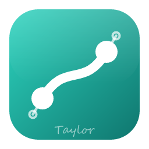

<p align="center">
  
</p>

<h1 align="center">Local Vector</h1>

<p align="center">
  <b>Vector illustration; an open-source, clean-room vector editor built in pure Rust.</b><br>
  Pen and path editing, Pathfinder, artboards, type, gradients, symbols and live effects,<br>
  in a native app written entirely in Rust. Offline, and yours.
</p>

<p align="center">
  
  
  
  <br>
</p>

<p align="center">
  <a href="https://github.com/Anon5T4R/Local-Vector"><b>Local Vector on GitHub</b></a> ·
  <a href="https://github.com/Anon5T4R/">Local</a> ·
  <a href="https://github.com/Anon5T4R">Anon5T4R</a>
</p>

<br>

---

## Get it

Installers are attached to each [GitHub release](https://github.com/Anon5T4R/Local-Vector/releases)
of this repository. There is no store, no account and no telemetry: the app never talks to a server
of ours, and the only network access is the update check against GitHub's public latest-release
endpoint (Help › Check for Updates runs one by hand).

| Platform | Files |
|---|---|
| Windows 10+ x64 / x86 / arm64 | `localvector-<ver>-windows-<arch>.msi` (per-machine, installs in `Program Files\Local Vector`) and `localvector-<ver>-windows-<arch>-portable.zip` |
| Linux x86_64 / aarch64 | `.AppImage`, `.deb`, `.rpm`, `.tar.gz`, and the single-file `.flatpak` (`packaging/linux/package.sh`) |
| macOS, FreeBSD, web (WebAssembly) | built by the scripts in `packaging/` |

## Build

```sh
git clone https://github.com/Anon5T4R/Local-Vector
cd Local-Vector
cargo run --release -p localvector            # the desktop app
cargo test --workspace                        # the test suite
```

Japanese and CJK fonts for the UI and the Type tool come from
[craft-fonts](https://github.com/storytold/craft-fonts), vendored under `assets/craft-fonts/` (the
release builds and CI pass it as `CRAFT_FONTS_DIR`). Without it the app uses your system's fonts.

Maintainers cut releases by pushing a `vX.Y.Z` tag; [`docs/releasing.md`](docs/releasing.md)
describes what the workflow builds and publishes. Contributors and agents start with
[`AGENTS.md`](AGENTS.md), then [`docs/`](docs/).

## Status

Local Vector is under active development. [**ROADMAP.md**](ROADMAP.md) has the stage, the numbers by
dimension and what's next; [`docs/target-app-parity.md`](docs/target-app-parity.md) the full parity
assessment and [`docs/gaps.md`](docs/gaps.md) the ranked list of what's missing.

**Where we are: alpha.** Drawing and path tools, Pathfinder and Shape Builder, paint, gradients,
appearance and transparency, type, artboards and files (SVG, PDF and PDF-compatible `.ai`, EPS, DXF,
EMF/WMF, raster formats) work end to end, and every action is a command that the CLI, the JSON
control channel and the MCP server can drive. The gaps are the ones the ROADMAP lists: reliable
`.ai` exchange in both directions, an interaction-fidelity pass over every tool, 3D beyond live
Revolve, and scripting.

## The Local suite

Local Vector is one of the **Local** apps: free, open-source creative tools from
[Anon5T4R](https://github.com/Anon5T4R/), each written from scratch in Rust, each offline and each
able to stand on its own. The vector app's siblings are **LocalPaint** (image editing),
**LocalPhoto** (photo library and raw development), **LocalVideo** (video editing, colour and
sound), **LocalPDF** (reading, organising and protecting PDFs), **LocalOffice**, **LocalSheets**
and **LocalSlides** (documents, spreadsheets and presentations).

## License and credits

Local Vector is dual-licensed under [MIT](LICENSE-MIT) or [Apache-2.0](LICENSE-APACHE), at your option.
Copyright (c) 2026 Local Team and the Local Vector contributors; the upstream copyright line is kept in
[`LICENSE-MIT`](LICENSE-MIT), and the derivation from VectorCraft (ArtCraft) is credited in
[NOTICE](NOTICE).

Bundled fonts, icons, images and other assets keep their own open licenses; each one is listed
with its author, source and license in [ASSETS.md](ASSETS.md). Release builds also embed the fonts
of [craft-fonts](https://github.com/storytold/craft-fonts/blob/main/ATTRIBUTION.md) (SIL Open Font
License 1.1). The app icon is original artwork made for the Local suite; its palette and files are
in [`assets/app-icon/`](assets/app-icon/README.md).

Fork independente, mantido por Anon5T4R na suíte Local. Créditos de código originais em
[NOTICE](NOTICE).

<p align="center">
  <sub>Suíte Local — apps locais, sem conta, sem telemetria.</sub>
</p>
